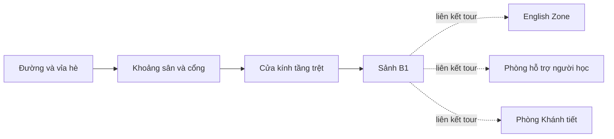

# Hồ sơ khảo sát UEH Cơ sở B: Tòa trung tâm và Sảnh B1

Ngày khảo sát: **05/11/2026**, múi giờ Asia/Bangkok.

Trạng thái khảo sát: **hoàn tất**. Bản tái dựng kiến trúc có ước lượng đã được triển khai theo prompt tiếp theo của người dùng; xem [bản dựng, ảnh xem trước và kết quả kiểm tra](BuildReview.vi.md). Các số liệu dự án trong phần khảo sát dưới đây mô tả thời điểm trước triển khai. Chưa có cơ sở nhận là mô hình đo đạc chính xác.

## 1. Phạm vi và mức độ chắc chắn

Mục tiêu đề xuất là dựng kiến trúc 3D có thể đi bộ, gồm mặt ngoài nhìn từ cổng và không gian sảnh nhìn thấy trong tour. Diện mạo trong các ảnh tour được chọn làm mốc. Chưa có dữ liệu chứng minh toàn bộ không gian hiện tại năm 2026 giống ảnh.

Ba loại thông tin trong hồ sơ:

- **Đã xác nhận:** đọc trực tiếp từ file dự án, tài nguyên web hoặc quan sát trong ảnh.
- **Suy luận:** cách các phần kiến trúc có thể nối với nhau; cần đối chiếu khi dựng.
- **Đề xuất:** thông số và cách triển khai do người dựng lựa chọn, có thể điều chỉnh.

Ở đợt khảo sát chỉ thêm tài liệu trong `Docs/UEH-CampusB`. Đợt triển khai tiếp theo tạo asset trong `Assets/UEHCampusB`, được ghi riêng ở [BuildReview.vi.md](BuildReview.vi.md). Ảnh panorama tham khảo vẫn đặt ngoài `Assets`.

## 2. Nguồn tham khảo đã lưu

| Mã | Nguồn | Vai trò | Bản cục bộ |
|---|---|---|---|
| R1 | [Tour Tòa trung tâm](https://virtualtour.ueh.edu.vn/360-virtual-tour/?campus=co-so-b&location=toa-trung-tam-csB) | Mặt ngoài, cổng, sân trước, quan hệ với đường | [toa-trung-tam.jpg](References/toa-trung-tam.jpg) |
| R2 | [Tour Sảnh B1](https://virtualtour.ueh.edu.vn/360-virtual-tour/?campus=co-so-b&location=sanh-b1-csB) | Sảnh, cửa kính, cột, trần, quầy và hành lang | [sanh-b1.jpg](References/sanh-b1.jpg) |
| R3 | [English Zone](https://virtualtour.ueh.edu.vn/360-virtual-tour/?campus=co-so-b&location=khu-english-zone-xanh-mat-csB) | Bối cảnh sân trong và các khối nhà phía sau | [English Zone](References/khu-english-zone-xanh-mat-csB.jpg) |
| R4 | [Phòng hỗ trợ người học](https://virtualtour.ueh.edu.vn/360-virtual-tour/?campus=co-so-b&location=phong-cham-soc-va-ho-tro-nguoi-hoc-csB) | Góc nhìn ngược qua kính về sảnh, cấu tạo vách/cột | [Phòng hỗ trợ](References/phong-cham-soc-va-ho-tro-nguoi-hoc-csB.jpg) |
| R5 | [Phòng Khánh tiết](https://virtualtour.ueh.edu.vn/360-virtual-tour/?campus=co-so-b&location=phong-khanh-tiet-csB) | Đối chiếu phong cách vật liệu; dữ liệu phụ | [Phòng Khánh tiết](References/phong-khanh-tiet-csB.jpg) |

Cả năm ảnh là JPEG **4080 × 2040**, tỷ lệ 2:1 phù hợp panorama equirectangular. Tổng dung lượng bản gốc khoảng **10,2 MiB**. `sources.json` giữ URL ảnh, URL trang và dữ liệu điểm chuyển cảnh; `audit.json` giữ kích thước, mã SHA-256 và số liệu dự án.

EXIF `DateTime` của hai ảnh chính là 02/03/2022; ba ảnh phụ có giá trị trong năm 2021. Không có `DateTimeOriginal` ở cấp EXIF đã đọc. Những giá trị này **không xác nhận ngày chụp** và không chứng minh tình trạng công trình hiện tại.

Nguồn văn bản chính thức bổ sung:

- [UEH: Khởi công mở rộng văn phòng cơ sở B, 17/05/2018](https://ueh.edu.vn/cuoc-song-ueh/tin-tuc/ueh-khoi-cong-xay-dung-cong-trinh-mo-rong-van-phong-lam-viec-co-so-b-3510?app=true): thông số dự án gồm cao 55 m, 15 tầng nổi, 2 tầng hầm; khu đất 5.441,9 m², tổng sàn 22.602,7 m².
- [UEH: Virtual Alumni Tour, 2021](https://future.ueh.edu.vn/tin-hang-ngay/chuong-trinh-ve-tham-truong-truc-tuyen-ket-noi-cac-the-he-cuu-sinh-vien-ueh/): liên hệ tòa B1 với Smart Campus 15 tầng.

**Giới hạn áp dụng:** số liệu 2018 mô tả dự án mở rộng. Chưa có bản vẽ để gán số đo đó cho từng phần mặt đứng trong panorama. Không lấy diện tích khu đất làm diện tích sảnh, không chia tổng sàn cho 15 để suy ra mặt bằng tầng trệt. Ảnh bổ sung B1 được liên kết từ bài Alumni hiện trả 404 khi kiểm tra, nên không dùng làm bằng chứng hình học.

## 3. Cấu trúc thật của trang tour

Đã đọc HTML và [mã trình xem tour](https://virtualtour.ueh.edu.vn/js/module.ueh-virtualtour.js). Trình xem tạo `PANOLENS.ImagePanorama` từ đường dẫn JPEG. Các điểm bấm được lấy bằng yêu cầu đọc dữ liệu tại `/360-virtual-tour/get-location-hotpot`.

Trong các tài nguyên và luồng tải đã khảo sát, hình ảnh hiển thị được tạo bằng panorama; chưa tìm thấy mesh, bản vẽ, depth map hay phép đo để tải thành công trình 3D.

`data-x/y/z` và `positionX/Y/Z` điều khiển hướng nhìn hoặc điểm đánh dấu trên quả cầu panorama. Chúng **không phải** tọa độ khảo sát, mét, vị trí camera trong khuôn viên hoặc khoảng cách giữa hai khu vực. Một số điểm có độ dài vector gần 5.000 chỉ phản ánh cách đặt điểm trên quả cầu.

Các liên kết đáng chú ý đã xác nhận:

| Điểm xuất phát | Điểm đích | Ý nghĩa có thể dùng |
|---|---|---|
| Tòa trung tâm | Sảnh B1 | Hai cảnh được tour nối trực tiếp |
| Sảnh B1 | Tòa trung tâm | Có đường quay lại trong tour |
| Sảnh B1 | English Zone | Có liên kết với sân trong |
| Sảnh B1 | Phòng hỗ trợ người học | Có liên kết với không gian dịch vụ |
| Sảnh B1 | Phòng Khánh tiết | Có liên kết đến phòng chức năng |
| Tòa trung tâm | Khu phức hợp ở Cơ sở V | Tour có cả liên kết sang cơ sở khác |

Điểm cuối chứng minh rằng **liên kết tour không đồng nghĩa tiếp giáp vật lý**. Không thể mặc định Phòng Khánh tiết nằm cạnh sảnh hoặc cùng tầng chỉ vì có điểm bấm. Với tuyến ngoài → sảnh, kính, cột và hình ảnh ngoài đường cho phép đối chiếu thêm, nhưng vẫn phải căn chỉnh khi dựng.

## 4. Phân tích hình học mặt ngoài

Các dấu hiệu nhận diện nhìn rõ ở R1:

- Khối kiến trúc sáng màu, các dải sàn và nhịp đứng lặp lại.
- Hệ cửa kính xanh/xám và các mảng lam ngang; phần lam gần lối vào có điểm nhấn đỏ/cam.
- Ban công, lan can, cây và hoa tại các tầng thấp.
- Dòng chữ tên trường màu xanh trên mặt đứng.
- Không gian tầng trệt nhìn xuyên qua kính; cột tạo nhịp trước sảnh.
- Cổng xếp đang thu về một bên, các trụ/bồn cây đá và khoảng mở dẫn vào.
- Gạch vỉa hè có hoa văn, bồn cây dọc đường, cây lớn và nền phố bên ngoài.

Ưu tiên hình học khi dựng: silhouette tổng thể → nhịp tầng/cột → khoảng mở tầng trệt → kính và lam → bảng chữ → cây/cổng/chi tiết.

**Điểm dễ dựng sai:** đường thẳng ở ảnh panorama bị uốn khi trải ra mặt phẳng. Không kết luận mặt đứng hoặc sàn cong chỉ từ ảnh JPEG trải. Chưa khóa số nhịp và tầng bằng cách đếm pixel vùng gần đỉnh ảnh. Cần xem dưới phép chiếu phối cảnh hoặc so sánh góc camera trong Unity trước khi chốt.

Khối mặt ngoài sẽ có cửa và vỏ tường rỗng ở tầng trệt; không dùng một hộp đặc chứa toàn bộ nội thất. Cửa kính cần có khung và khoảng thông thủy thật để người chơi đi qua.

Mặt sau, mái, tầng hầm, lõi kết cấu và các không gian bị che chưa có đủ tham chiếu. Bản dựng đầu tập trung các mặt nhìn thấy từ tuyến tham quan; hình học bổ sung phải được ghi là giả định.

## 5. Phân tích sảnh B1

Các dấu hiệu nhận diện nhìn rõ ở R2:

- Không gian mở với các cột vuông ốp đá màu be.
- Sàn sáng màu chia ô và có dải viền đậm hơn; độ bóng tạo phản chiếu lớn.
- Mảng trần trắng kết hợp dải nan gỗ màu nâu, đèn âm trần và đèn treo trang trí.
- Cửa/vách kính cao, khung kim loại và ánh sáng ban ngày từ phía mặt ngoài.
- Quầy tiếp đón với vách chữ trang trí có các từ WELCOME, TO, UEH.
- Mảng nhận diện 1976 trên nền cây xanh và các mảng trang trí màu.
- Vùng viền ánh sáng xanh, không gian ngồi, chậu cây và hành lang phía trong.
- Các thiết bị đứng/đường kiểm soát gần cửa; cần giữ một tuyến đi bộ thông suốt.

R4 bổ sung góc nhìn qua vách kính về sảnh và cho thấy vật liệu cột, màu sàn, các cửa hướng về khu trong. R3 bổ sung sân trong. R5 chủ yếu giúp đối chiếu phong cách và không xác lập được vị trí chính xác của phòng trong mặt bằng.

Điều cần giữ nhất là tỷ lệ không gian, nhịp cột, dải trần gỗ, màu sàn và hai mảng nhận diện. Chỉ thay màu vài khối hộp sẽ chưa tái hiện được sảnh.

Không dựng một bóng đèn thời gian thực cho mỗi đèn nhìn thấy. Các đèn nhỏ có thể dùng hình học và vật liệu phát sáng, kết hợp hệ chiếu sáng tổng thể phù hợp.

## 6. Mặt bằng làm việc và cách căn tỷ lệ

Sơ đồ dưới đây là **quan hệ làm việc đề xuất**, không phải mặt bằng công trình đã đo. Nhánh đứt nét chỉ biểu diễn liên kết tour.



Quy ước đề xuất cho prefab: 1 Unity unit = 1 m; Y hướng lên; mặt chính hướng +Z; gốc tổng thể ở giữa ngưỡng vào trên cao độ sàn hoàn thiện. Mỗi prefab có transform rõ ràng, tỷ lệ gốc `(1,1,1)`, các chi tiết dùng tọa độ tương đối.

Các tham số cần cho phép chỉnh: bề rộng mặt tiền, chiều sâu sảnh, chiều cao trần, nhịp cột, bề rộng cửa, cao độ vỉa hè/sàn, vị trí quầy và khoảng lùi.

| Tham số | Căn cứ | Quyết định lúc triển khai |
|---|---|---|
| Chiều cao khối B1 | Có thông số dự án 55 m | Dùng để đối chiếu khối cao tầng phù hợp; không áp đồng loạt cho toàn mặt ngoài |
| Rộng/sâu sảnh | Chưa có số đo | Dựng thử bằng nhịp cột và không gian sử dụng; giữ tham số có thể sửa |
| Kích thước viên gạch | Ảnh có đường chia ô, chưa có kích thước | Không coi 600/800 mm là số đo thực tế |
| Chiều cao camera tham chiếu | Chưa xác định | Camera người chơi 1,65 m là quy ước game |
| Cửa đi chính | Phải phù hợp nhân vật trong dự án | Đề xuất lối chính rộng tối thiểu 1,2 m; đây là tiêu chí gameplay |
| Ngưỡng/bậc cửa | Có thay đổi cao độ ở khu ngoài | Ưu tiên nối êm; kiểm tra với step offset hiện tại 0,3 m |

Cách dựng từ ảnh: căn các đường đứng và nhịp lặp dưới góc nhìn phối cảnh, dùng hình khối ước lượng, so sánh những vật thể chung giữa R1/R2/R4 rồi tinh chỉnh. Không có baseline camera hoặc số đo để giải bài toán tái dựng đa góc chính xác; các panorama ở những không gian khác nhau không tự đủ cho photogrammetry.

## 7. Kết quả khảo sát dự án Unity

Đọc trực tiếp dữ liệu đang có trong workspace, không chạy Editor hoặc Play Mode trong đợt này.

| Mục | Kết quả |
|---|---|
| Unity | 6000.6.8f1; có Editor tại `C:/Program Files/Unity/Hub/Editor/6000.6.8f1/Editor/Unity.exe` |
| Render pipeline | Built-in; Graphics Settings và các Quality tier không gán SRP asset |
| Package liên quan | glTFast 6.9.0, TextMesh Pro 3.0.9, Input System 1.20.1 |
| Scene chính | `Assets/Scenes/GameWorld.unity` |
| Scene nháp | `Assets/Scenes/BuildingDraftSandbox.unity` |
| Xưởng nháp | Baseplate 120 × 120 m, lưới tham chiếu và capsule cao 1,7 m |
| Camera game | FOV 68°, near 0,1 m, far 320 m |
| Player collider | Cao 1,8 m; bán kính 0,35 m; tâm Y 0,9 m; step offset 0,3 m |
| Camera người chơi | `eyeHeight = 1.65` |
| Đi/chạy trong scene | 4,8 / 7,8 m/s |
| Điều khiển | WASD, chuột; có New Input System và nhánh Legacy |

Đếm các block được serialize trong `GameWorld.unity`:

| Loại | Số lượng |
|---|---:|
| GameObject | 1.803 |
| Mesh Renderer | 1.751 |
| Box Collider | 1.574 |
| Mesh Collider | 0 |
| Light | 9 |
| Camera / Character Controller | 1 / 1 |
| Reflection Probe hiện diện tường minh | 0 |
| Material nhúng trong scene | 1.735 |
| Prefab Instance | 0 |

Toàn bộ 1.803 GameObject có `m_StaticEditorFlags = 0`. Các số trên là dữ liệu file, **không phải draw call, đối tượng đang hoạt động, FPS hoặc kết quả profiling**. Scene có thể vẫn dùng phản chiếu môi trường mặc định dù không có Reflection Probe đặt riêng.

### Các ràng buộc ảnh hưởng trực tiếp đến bản dựng

1. **UEH hiện là mẫu nhà phố đặc.** `GameSceneBuilder.BuildCampusSide()` gọi mẫu rộng 18 m, cao 14 m, sâu 10 m, tâm hình học `(22,7,-17)`. `BuildingBody` đặc chặn không gian bên trong. Không thể chỉ đặt sảnh vào trong khối hiện có rồi đi vào.
2. **Gốc nhóm hiện tại không ở tâm công trình.** Nhóm UEH ở `(0,0,0)` còn các con chứa tọa độ của bản đồ. Khi thay bằng prefab cần quy đổi vị trí/hướng, tránh coi transform của nhóm cũ là cổng vào.
3. **Thiếu khoảng rộng nếu giữ tâm cũ.** UEH chiếm X từ 13 đến 31; quán Chạm rộng 13 m, tâm X -0,5, mép phải X 6. Nếu một bản dựng rộng 40 m vẫn đặt tâm X 22 thì mép trái X 2, chồng lên quán khoảng 4 m. Đây là ví dụ bố trí, không phải khẳng định mặt tiền thật rộng 40 m.
4. **Công cụ dựng toàn cảnh có thể ghi đè scene chính.** `BuildFullScene()` tạo scene mới và lưu về `GameWorld.unity`. Dựng UEH bằng công cụ riêng và scene riêng trước khi tích hợp.
5. **Material hiện được tạo mới theo từng khối.** `CreateBox()` tạo `new Material` và gán vào renderer. Cần thư viện `sharedMaterial` cho các mô-đun lặp, sau đó cân nhắc gom mesh theo khu/vật liệu.
6. **Sàn B1 chưa phải vật liệu hoàn thiện.** `B1_InnerTiles/Sidewalk_Tiles.mat` trỏ texture GUID của `Draft_Grid.png`, màu tint vàng/cam và glossiness 0. Đây không phải nền gạch sáng bóng nhìn trong R2.
7. **Texture lát ngoài thiếu trong Assets.** `OuterTiles/Sidewalk_Tiles.mat` tham chiếu GUID `5bdf01a50b7e3514dae4496e385ceee5`, chưa tìm thấy `.meta` tương ứng trong `Assets` lúc khảo sát. Chưa xác định ngoại lệ nào từ Editor; cần thay tham chiếu hợp lệ khi làm vật liệu mới.
8. **Spawn runtime có thể khác vị trí trong scene.** Player serialize tại `(18.5,0.15,2.8)`; `PlayerController.Start()` lấy spawn từ `GameManager.State` nếu có. Giá trị mặc định/khởi tạo là `(-18,0,-13)`. Điểm xuất phát của scene khảo sát cần độc lập với save game.
9. **Các điểm tương tác đang cố định theo tọa độ.** `WorldSetup` có `friend` tại `(18.5,0.5,-11.5)` và `teacher` tại `(25.5,0.5,-22.5)`. Di chuyển công trình cần kiểm tra lại vị trí này. Chúng không tự gắn vào prefab UEH.
10. **Môi trường có logic tự sinh lúc chạy.** `WorldSetup.Start()` kiểm tra nền, player, camera, sinh điểm tương tác và thiết lập ánh sáng. Scene khảo sát không nên gắn toàn bộ GameCore chỉ để có camera đi bộ.
11. **GameCore tồn tại qua lần tải scene.** `GameManager` gọi `DontDestroyOnLoad` trên GameObject dùng chung với các component core khác. Cần tránh tạo trùng core, player và nguồn sáng khi mở scene khảo sát từ game.
12. **Khoảng kích hoạt không lấy trực tiếp từ radius của zone.** Bộ chọn tương tác trong PlayerController dùng khoảng 3 m; radius mặc định trên zone là 2 m. Không dùng trường radius để giả định cửa sẽ tự mở đúng khoảng cách.
13. **Công cụ xóa nội thất có thể xóa nhầm đồ mới theo tên.** Có bộ lọc `desk`, `chair`, `table`, `prop_`, v.v. trong GameSceneBuilder. Không gọi công cụ này trên scene UEH đã hoàn thiện để dọn cảnh.
14. **Biển chữ cần đối chiếu dấu tiếng Việt.** Atlas mặc định LiberationSans chưa chứa sẵn một số ký tự trong tên trường, gồm Đ, Ạ, Ế, Ọ, Ố, Ồ. Có fallback động nên chưa kết luận lỗi hiển thị; phải xem thực tế hoặc chuẩn bị font asset riêng khi triển khai.

## 8. Phương án triển khai đề xuất

Tạo công cụ Editor riêng, ví dụ `UEHCampusBuilder`, để sinh hình học và lưu thành asset thật. Đường dẫn dưới đây là kế hoạch, chưa được tạo:

```text
Assets/UEHCampusB/
  Editor/UEHCampusBuilder.cs
  Prefabs/UEH_Exterior.prefab
  Prefabs/UEH_LobbyB1.prefab
  Prefabs/UEH_CampusB.prefab
  Materials/
  Meshes/
  Textures/
  Scenes/UEH_CampusB_Study.unity
```

Prefab tổng gắn hai prefab thành phần vào cùng hệ tọa độ. Cấu trúc mỗi phần có nhóm kiến trúc, trang trí, collider và điểm căn camera. Các mô-đun kính, cột, lam, sàn và đèn dùng chung dữ liệu phù hợp.

Các mesh sinh trong Editor phải lưu thành `.asset`; vật liệu và texture cũng phải là asset có tham chiếu bền vững. UV, normals, tangents và UV lightmap cần chuẩn bị theo cách dùng vật liệu/ánh sáng. Mở lại project phải giữ đầy đủ model.

Hướng này phù hợp môi trường hiện có: chủ động dựng hình bằng Unity và C#, chỉnh được trong Hierarchy, không cần thêm công cụ ngoài cho bước đầu. Chưa xác nhận có Blender trong PATH. Nếu sau này cần FBX/GLB xuất ra phần mềm khác thì đánh giá riêng công cụ xuất và vật liệu; prefab không tự đồng nghĩa một file FBX.

### Vật liệu và chiếu sáng

| Bề mặt | Hướng xử lý đề xuất |
|---|---|
| Tường và dải sàn ngoài | Standard, màu trắng ngà, độ bóng thấp |
| Cột/sàn sảnh | Vật liệu đá be riêng; hoa văn và mạch theo tỷ lệ thế giới |
| Sàn sảnh | Roughness thấp hơn tường, có phản chiếu môi trường được kiểm soát |
| Kính | Standard với chế độ trong suốt phù hợp; thử thứ tự vẽ ở các vách giao nhau |
| Nan gỗ | Mesh tạo chiều sâu ở vùng gần; texture lặp cho chi tiết nhỏ/xa |
| Kim loại/lam/cổng | Vật liệu dùng chung theo nhóm; chi tiết chính bằng mesh |
| Chữ và mảng nhận diện | Hình học/text hoặc texture phẳng phù hợp; kiểm tra độ nét và dấu |
| Cây | Tán cây theo cụm; giới hạn vật liệu trong suốt và bóng đổ tốn kém |

Màu lấy từ JPEG chỉ là tham khảo vì ánh sáng và cân bằng trắng đã nằm trong ảnh. Không dùng toàn cảnh panorama làm albedo cho mọi bề mặt: ảnh chứa phối cảnh, bóng đổ và phản chiếu gắn với một vị trí quan sát.

Built-in đáp ứng được hướng vật liệu này. [Tài liệu Unity về Reflection Probe](https://docs.unity3d.com/6000.0/Documentation/Manual/RefProbeTypes.html) giải thích baked probe có chi phí cập nhật thấp hơn realtime nhưng không phản ánh chuyển động mới. Đề xuất dùng baked reflection probe theo vùng cho bản đầu; phản chiếu mặt sàn sẽ là xấp xỉ và cần xem dưới góc nhìn người chơi.

Chiếu sáng đề xuất: một nguồn nắng, ánh sáng môi trường có kiểm soát, các nhóm đèn sảnh và nguồn sáng trang trí. Bake ánh sáng tĩnh sau khi khóa hình học; đặt Light Probe cho đối tượng động nếu cần. Lightmap thuộc scene bố trí cuối và phải bake lại khi thay vị trí/hình học đáng kể.

### Hiệu năng và va chạm

- Dùng vật liệu chung thay vì một material cho từng thanh lam. [Tài liệu Unity về batching](https://docs.unity3d.com/6000.0/Documentation/Manual/static-batching.html) mô tả cơ chế gom các mesh phù hợp dùng chung material.
- Gom chi tiết tĩnh theo từng mặt đứng hoặc từng vùng; giữ khả năng loại bỏ phần không nhìn thấy. Không ghép cả khuôn viên thành một mesh khổng lồ ngay từ đầu.
- Dùng Box Collider cho tường/cột/sàn; Mesh Collider tĩnh chỉ ở hình dạng thật sự cần. Thanh lam, chữ, nan trần và lá không cần mỗi chi tiết một collider.
- Giữ cửa thông suốt khi dựng thử. Nếu thêm cửa tự động sau này, collider và hoạt ảnh phải mở cùng nhau.
- Xử lý ngưỡng sàn và bậc bằng hình học đi được; không đặt một collider kín ngang cửa dù vật liệu kính trong suốt.
- Đề xuất ban đầu: khoảng 15–25 material dùng chung, 150–300 renderer sau khi gom, 100k–300k tam giác cho vùng chính; texture chủ yếu 1K–2K, 4K khi cận cảnh thực sự cần. Đây là ngân sách làm việc cho máy tính, chưa là giới hạn được đo hoặc cam kết FPS.
- Cần chọn thiết bị đích khi tối ưu cuối. Hiện chưa có yêu cầu PC/mobile/VR và chưa có benchmark phần cứng.

## 9. Trình tự làm và tiêu chí nghiệm thu

| Bước | Kết quả cần có | Điều kiện đi tiếp |
|---|---|---|
| 1. Dựng bố cục | Scene riêng, khối ngoài và sảnh rỗng, cột/cửa ở vị trí ước lượng | Đi từ sân vào sảnh được; tỷ lệ người/cửa hợp lý |
| 2. Khóa kiến trúc chính | Nhịp tầng, kính, lam, ban công và dải trần | So sánh được với hai ảnh chính dưới góc camera tương ứng |
| 3. Vật liệu và nhận diện | Sàn/đá/gỗ/kính, chữ tên trường, 1976, quầy và vách WELCOME | Dễ nhận ra từng khu vực, không có vật liệu lỗi hoặc sai dấu |
| 4. Ánh sáng | Cân bằng ngoài/trong, phản chiếu sàn, đèn trang trí | Không chói cửa, tối sảnh hoặc phản chiếu lệch rõ rệt |
| 5. Tối ưu và lưu asset | Mesh/material/prefab lưu bền vững, collider có chủ đích | Mở lại scene không mất model; thống kê chi phí hiển thị thực tế |
| 6. Ghép vào game | Xử lý chỗ đặt và các điểm tương tác | Không chồng kiến trúc; spawn và tương tác vẫn tiếp cận được |

Các góc cần kiểm tra: ngoài cổng nhìn chính diện; hai góc chéo mặt ngoài; ở ngưỡng cửa nhìn vào; giữa sảnh nhìn về quầy; giữa sảnh nhìn ngược ra cửa; nhìn dọc hành lang phía trong.

Kiểm tra kỹ thuật lúc triển khai: lỗi biên dịch/import; mở scene và Play Mode; tuyến đi ở tốc độ thường/chạy; khoảng cửa với capsule hiện có; nền không hở hoặc nhấp nháy; không trùng camera/AudioListener; prefab không mất material sau mở lại; profiler/Frame Debugger trên thiết bị đích. Đây là kế hoạch kiểm tra, **chưa phải các kiểm tra đã chạy**.

## 10. Dữ liệu còn thiếu và cách quyết định

| Còn thiếu | Ảnh hưởng | Cách xử lý bản đầu |
|---|---|---|
| Mặt bằng có số đo | Sai số chiều rộng, sâu, vị trí lõi | Giữ tham số, ghi rõ ước lượng |
| Ảnh/đo mặt sau và mái | Không đủ dữ liệu toàn bộ công trình | Mô hình hóa phần hỗ trợ nhìn thấy ở mức cần thiết |
| Độ cao ngưỡng, bậc và cửa | Khả năng đi lại | Căn theo gameplay rồi ghi nhận phần giản lược |
| Vị trí thực của các phòng/tầng | Khó dựng đầy đủ tuyến phụ | Chỉ tạo phần kết thúc hành lang hợp lý ở bước đầu |
| Hiện trạng mới so với ảnh tour | Có thể khác nhận diện hiện nay | Dùng diện mạo trong tour theo phạm vi đã khảo sát |
| Thiết bị và phong cách đích | Ngân sách chất lượng/hiệu năng | Bản đầu theo hướng kiến trúc tự nhiên chạy trên máy tính |
| Chỗ đặt công trình trong GameWorld | Có thể phải bố trí lại khu đất | Chốt sau khi có footprint bản dựng độc lập |

Không có điểm thiếu nào ở trên cản trở bắt đầu bản dựng ước lượng. Chúng cản trở việc hứa độ chính xác khảo sát hoặc tự ý ghép một công trình lớn vào vị trí cũ.

## 11. Prompt để bắt đầu triển khai

Khi muốn bắt đầu, người dùng có thể gửi:

> Bắt đầu dựng 3D Tòa trung tâm và Sảnh B1 UEH theo hồ sơ Docs/UEH-CampusB/Survey.vi.md. Tạo scene riêng có thể đi bộ từ ngoài vào sảnh và hai prefab chỉnh sửa được; bám ảnh tour, ghi rõ kích thước ước lượng. Hoàn thiện hình học, vật liệu, ánh sáng và kiểm tra trong Unity. Chỉ tích hợp vào GameWorld sau khi có bản dựng độc lập để tôi xem.

Người dùng đã gửi prompt triển khai tương ứng. Kết quả bản dựng độc lập và hướng dẫn duyệt nằm tại [BuildReview.vi.md](BuildReview.vi.md).
